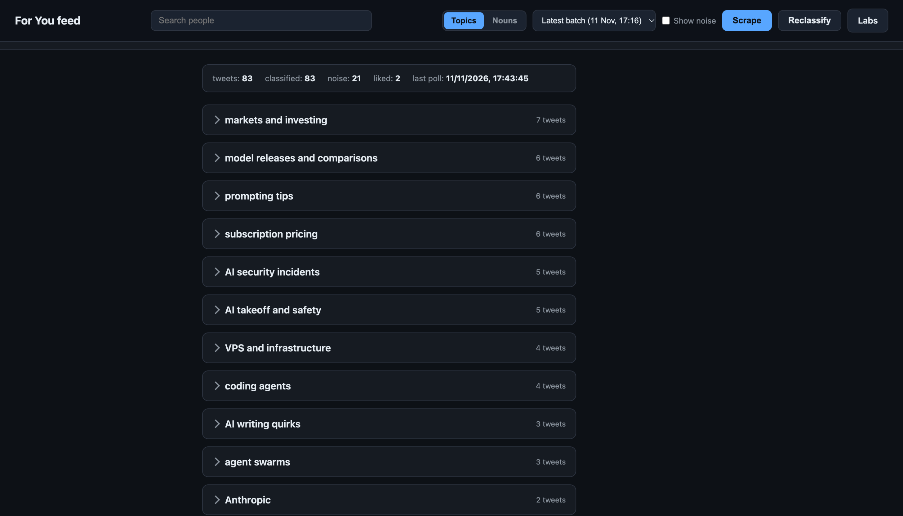
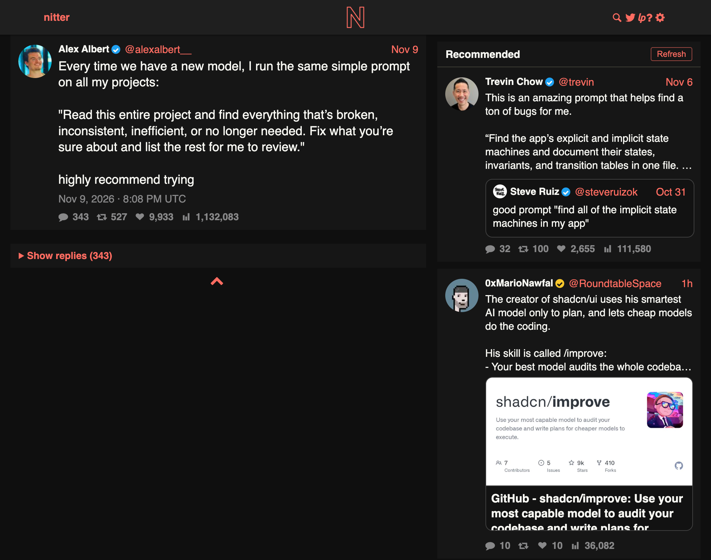

# x-nitter

A personal fork of [Nitter](https://github.com/zedeus/nitter). Plain Nitter is
a lightweight, read-only front-end for X (Twitter). This fork adds a personal,
logged-in feed dashboard on top: it fetches your **For You** timeline using
your own X account, keeps every tweet in a local database, and uses an LLM to
sort the feed into topics you define — so you can browse, search and like your
timeline without ads, algorithm noise or the official app. Nitter's front-end
(public profiles, tweet pages, RSS) still works exactly as before.

<p align="center">
  
  
</p>

## Why?

This replaces the X timeline with a click-and-fetch timeline. It de-slopifys
your feed and sorts it by topics. If you want to fetch the timeline again, you
gotta burn tokens again — though it's not that expensive.
It supports Like/Follow to nudge the timeline in the right direction.
There's no ability to reply or post, though — that's to keep the experience
non-addictive, without endless scrolling.

## How it works

- **Feed dashboard** — a web UI served at `http://localhost:8080/xtime/` from
  the same server as Nitter. It shows your scraped For You feed grouped by
  topic, with a search/filter view.
- **People search** — the search box in the dashboard's top bar looks people
  up through X's People search and opens their profile here. People you open
  are remembered in the local database (`/api/people/recent`) and listed when
  the box is empty (× forgets one).
- **Logged-in timeline scraping** — the feed is fetched in batches with your
  own X session through a small Python helper bundled with the project, which
  uses a browser-impersonating client so X treats it like a normal browser.
  Scrapes can be triggered from the dashboard UI or the API.
- **Local tweet store** — every batch is persisted to a local SQLite database,
  so browsing is instant and works offline.
- **LLM classification & translation** — tweets are classified into your
  configured topics and optionally translated, via any OpenAI-compatible API.
- **Interactions** — like/unlike tweets and follow/unfollow accounts directly
  from the dashboard.
- **Tweet recommendations (experimental, off by default)** — switch it on
  from the dashboard's **Labs** menu; the setting is saved in the local
  database. While it is on, every tweet page gets a **Recommended** button
  in the sidebar; clicking it finds 4-5 tweets worth reading next (nothing
  runs until you click). The LLM reads the tweet and a sample of its replies,
  writes three X searches (the core topic, an angle the replies raise, and
  fresh takes), then picks the best results with a one-line reason each.
  The tweet's replies fold under a **Show replies** toggle.
  Results are kept in memory per tweet until the server restarts and show
  without a click when you reopen the tweet; the sidebar's Refresh button
  runs it again. How many replies it reads, how many tweets it suggests and
  how far back the searches look are set under `recommend` in
  `xtime.config.json`.
- **Profile summaries**: the ✦ button next to a profile's follow button
  toggles a section above the bio summarizing the user's posts, quotes and
  replies from the last two weeks (up to 100, no plain retweets): a
  one-line overview, then one line per topic they post about with their
  stance on it. Summaries are saved in the `user_summaries` table of
  `feed.db` until the section's Refresh link writes a new one. The window
  and limits are set under `summary` in `xtime.config.json`.
- **Live translation**: on profiles, tweet pages and search, non-English
  tweets, quoted tweets and the bio are translated to English in place, with
  a "Translated from Japanese · Show original" toggle under each. X's own
  language code on every tweet decides what is sent (bios have none, so a bio
  is sent when it is in a non-Latin script or most of the page's tweets are
  non-English); English and Hindi written in Latin letters are left as they
  are. A small box in the top-right corner shows progress and offers Retry if
  a request fails. Links, @mentions and #hashtags stay clickable. Results are
  saved in the `translations` table of `feed.db`, so a page seen before
  translates instantly. Turning **Translate non-English tweets
  automatically** off in Preferences puts a Translate link under each one
  instead.
- **Scrape API** — trigger scrapes and reclassification from the UI or curl.
- All upstream Nitter features remain: no-JS front-end, RSS, themes,
  lightweight pages.

## Setup

You need Docker, an X account, and an API key for an OpenAI-compatible LLM
API (the default config uses [OpenRouter](https://openrouter.ai/keys)).

1. **Copy two cookies from X.** Log in to x.com in your browser, open
   DevTools → Application (Firefox: Storage) → Cookies → `https://x.com`, and
   copy the values of `auth_token` and `ct0`. They last for months.
2. **Download x-nitter and fill in `.env`:**

   ```bash
   git clone https://github.com/tejush1998/x-nitter.git
   cd x-nitter
   cp .env.example .env   # AUTH_TOKEN, CT0 and LLM_API_KEY
   ```

3. **Start it:**

   ```bash
   docker compose up -d --build
   ```

4. Open `http://localhost:8080/xtime/` and click **Scrape**. Nitter's own
   pages (profiles, tweets, search, RSS) are at `http://localhost:8080/`.

Good to know:

- Everything the server keeps is in `./data`. On the first start it writes
  `nitter.conf` (with a random `hmacKey`) and `xtime.config.json` there, next
  to `feed.db` and `cache.db`. `xtime.config.json` sets the topics, the LLM
  and its fallbacks, with a comment on each setting. After editing either
  file, run `docker compose restart`.
- When a scrape fails with "Cookies are expired or invalid", copy fresh values
  into `.env` and run `docker compose up -d --force-recreate`.
- Treat the cookies like passwords: `.env` and `./data` hold them, and both
  are gitignored.
- Files in `./data` are owned by uid/gid 1000; set `PUID` and `PGID` in
  `.env` to change that.
- To update: `git pull && docker compose up -d --build`.
- To check it's working: `docker compose logs` shows "successfully added 1
  valid account sessions", and `curl http://localhost:8080/api/status`
  returns the dashboard's job status.

## Without Docker

For working on the code, or to run x-nitter as a single native binary. You
need [Nim](https://nim-lang.org/install.html) 2.2, Python 3.10+, Node.js
20.6+ (only for `make_sessions.mjs`) and libsass; on Debian/Ubuntu also
`libpcre3` and `libsqlite3-0`. With `.env` filled in as above, from the repo
root:

```bash
nimble install -y --depsOnly
nimble scss && nimble md      # the CSS and the About page
cp nitter.example.conf nitter.conf
cp xtime.config.example.json xtime.config.json
python3 -m venv .venv && .venv/bin/pip install twifork curl_cffi
node --env-file=.env make_sessions.mjs
nim c -d:release -o:./xnitter src/nitter.nim && ./xnitter
```

- In `nitter.conf`, set `hmacKey` to a random value (`openssl rand -hex 32`).
  The example listens on all interfaces (`address = "0.0.0.0"`), so anyone on
  your network can use the dashboard, likes and follows included; set
  `address = "127.0.0.1"` to keep it on this machine.
- Re-run `make_sessions.mjs` after putting new cookies in `.env`.
- The server reads `nitter.conf`, `sessions.jsonl`, `xtime.config.json`,
  `feed.db` and `.env` from the folder it starts in. `NITTER_CONF_FILE`,
  `NITTER_SESSIONS_FILE`, `XTIME_CONF_FILE` and `XTIME_DB_FILE` point it
  elsewhere.
- Run one server per port: x-nitter binds with `reusePort`, so a second one
  on 8080 silently splits the requests with the first.
- The cache is a SQLite file (`cache.db`); build with `-d:redisCache` to use
  Redis/Valkey instead, as upstream Nitter does.
- On a Mac, `nimble scss` can't find Homebrew's libsass. Build the CSS
  generator and run it directly instead:
  `nim c -o:/tmp/gencss tools/gencss && DYLD_LIBRARY_PATH=/opt/homebrew/opt/libsass/lib /tmp/gencss`.

Based on [Nitter](https://github.com/zedeus/nitter) (AGPLv3).
